# Arquitectura y Fases del Sistema SISCON-CECIAMB

Documento técnico que detalla la arquitectura de software, el flujo de datos, el stack tecnológico y cada una de las fases de desarrollo del Sistema Contable del Hospital de Clínicas CECIAMB.

---

## 1. Stack Tecnológico y Lenguajes

| Capa | Tecnología | Lenguaje / Estándar | Función Principal |
| :--- | :--- | :--- | :--- |
| **Frontend** | React 19 + Vite 6 | JavaScript (ES Modules, JSX) | Interfaz reactiva SPA, componentes modulares, renderizado optimizado |
| **Estilos** | Tailwind CSS 4 | CSS moderno / PostCSS | Sistema de diseño institucional, modo claro/oscuro nativo |
| **Gestión de Estado y API** | TanStack Query v5 | JavaScript | Cacheo, revalidación y sincronización de estado de red |
| **Backend** | Node.js 24 + Express 5 | JavaScript (ESM estricto) | API RESTful modular (`/api/v1`), middleware de seguridad y auditoría |
| **Acceso a Datos** | Knex.js + mysql2 | SQL parametrizado / JS Query Builder | Migraciones de esquema, seeds, transacciones ACID y bloqueos |
| **Base de Datos** | MariaDB Server 13 | SQL (InnoDB, utf8mb4_unicode_ci) | Integridad referencial, triggers de inmutabilidad y auditoría |
| **Formatos y Reportes** | ExcelJS + PDFKit | JavaScript | Generación nativa de hojas de cálculo `.xlsx` y documentos PDF |

---

## 2. Diagrama de Arquitectura y Fases del Sistema

```mermaid
graph TD
    subgraph CAPA_FRONTEND["Capas de Aplicación (JavaScript / React 19)"]
        UI_SPA["Cliente Web SPA (Vite + React 19 + Tailwind CSS 4)"]
        UI_MODS["Módulos: Comprobantes | Libros | Estados Financieros | Cuentas | Períodos | Seguridad"]
        UI_HTTP["Cliente HTTP & Cache (TanStack Query v5 + JWT Cookie)"]
        UI_SPA --> UI_MODS --> UI_HTTP
    end

    subgraph CAPA_BACKEND["Capas de Servidor (Node.js 24 / Express 5)"]
        API_GATEWAY["API REST Express (/api/v1)"]
        MW_SEC["Middlewares: Auth JWT | Roles & Permisos | Validación Zod | Bitácora"]
        SVC_CONT["Servicios de Negocio: ComprobantesService, LibrosService, BalanceService..."]
        REPO_KNEX["Capa de Datos Knex.js (Transacciones ACID & SELECT FOR UPDATE)"]
        API_GATEWAY --> MW_SEC --> SVC_CONT --> REPO_KNEX
    end

    subgraph CAPA_DATOS["Base de Datos Relacional (MariaDB Server 13)"]
        DB_TABLES["Tablas Relacionales (InnoDB, DECIMAL 18,2)"]
        DB_TRIGGERS["Triggers de Inmutabilidad (Comprobantes Aprobados & Bitácora)"]
        DB_CONSTRAINTS["Restricciones de Integridad (FK, CHECK Debe/Haber)"]
        REPO_KNEX --> DB_TABLES
        DB_TABLES --- DB_TRIGGERS
        DB_TABLES --- DB_CONSTRAINTS
    end

    UI_HTTP <==>|HTTP / JSON (REST)| API_GATEWAY
```

---

## 3. Diagrama de Fases del Sistema (Ruta Crítica y Crecimiento)

```mermaid
flowchart TD
    classDef completado fill:#1e8a5a,stroke:#145e3d,color:#ffffff,stroke-width:2px;
    classDef enprogreso fill:#004191,stroke:#00295c,color:#ffffff,stroke-width:2px;
    classDef futuro fill:#5a6782,stroke:#3b4457,color:#ffffff,stroke-width:1px,stroke-dasharray: 4 4;

    F0["Fase 0: Setup y Arquitectura Base\n• Node.js 24, Express 5, React 19, MariaDB 13\n• Monorepo Workspaces & CI Actions"]:::completado
    F1["Fase 1: Seguridad, Permisos y Bitácora\n• JWT HttpOnly, Bloqueo de Intentos\n• Matriz Dinámica de Roles y Permisos\n• Bitácora Inmutable en BD (Triggers)"]:::completado
    F1B["Fase 1b: Tasas Cambiarias y Divisas\n• Sincronización oficial BCV y Binance P2P\n• Histórico cambiario y conversor Bs / USD / EUR"]:::completado
    F2["Fase 2: Empresa, Ejercicios y Períodos\n• Datos RIF y Razón Social CECIAMB\n• Ejercicios contables y 12 períodos mensuales\n• Cierre cronológico y reaperturas justificadas"]:::completado
    F3["Fase 3: Plan de Cuentas Jerárquico\n• Estructura jerárquica VEN-NIF (6 niveles)\n• Centros de costo clínicos\n• Validador de cuentas de movimiento"]:::completado
    F4["Fase 4: Motor Central de Comprobantes\n• Partida doble con validación de cuadre (Debe = Haber)\n• Correlativos sin saltos (SELECT FOR UPDATE)\n• Inmutabilidad de aprobados (Triggers MariaDB)\n• Consulta analítica de detalles estilo Sparrow"]:::completado
    F5["Fase 5: Libros Legales Obligatorios\n• Libro Diario y Libro Mayor Analítico\n• Exportación oficial Excel (.xlsx) y PDF carta/oficio\n• Cálculo progresivo de saldos acumulados"]:::completado
    F6["Fase 6: Operación, Soporte y Dashboard\n• Dashboard con métricas y alertas de borradores\n• Importación de resúmenes CSV/Excel\n• Adjuntos de documentos digitales con hash SHA-256"]:::completado
    F8A["Fase 8 (Adelantada): Estados Financieros\n• Balance de Comprobación a 8 Columnas\n• Balance General clasificado VEN-NIF\n• Estado de Resultados (Utilidad Bruta, Operativa y Neta)"]:::completado

    F7["Fase 7: Carga Sparrow, UAT y Release v1.0\n• Importación de saldos y asientos históricos de CECIAMB\n• Auditoría y cotejo contable con Sparrow\n• Respaldos automáticos programados (mysqldump)\n• Puesta en marcha en red local de CECIAMB"]:::enprogreso

    F8B["Fase 8 (Segunda Parte): Tesorería Avanzada\n• Conciliación Bancaria Automática (Extractos vs Mayor)\n• Gestión Multimoneda y Diferencial Cambiario BCV"]:::futuro
    F9["Fase 9: Cuentas por Cobrar (CxC)\n• Facturación a Aseguradoras y Pacientes\n• Control de cobranza, anticipos y retenciones"]:::futuro
    F10["Fase 10: Cuentas por Pagar (CxP)\n• Proveedores de Insumos Médicos y Fármacos\n• Comprobantes de Retención IVA / ISLR"]:::futuro
    F11["Fase 11: Honorarios Médicos y Nómina\n• Liquidación de honorarios a especialistas de CECIAMB\n• Nómina clínica y generación automática de asientos"]:::futuro
    F12["Fase 12: Activos Fijos y Depreciación Médica\n• Registro de equipos médicos de alta tecnología\n• Cálculo y contabilización automática de depreciaciones"]:::futuro

    F0 --> F1 --> F1B --> F2 --> F3 --> F4 --> F5 --> F6 --> F8A --> F7
    F7 --> F8B --> F9 --> F10 --> F11 --> F12
```



---

## 4. Detalle Técnico Fase por Fase

### Fase 0: Setup y Arquitectura de Base
- **Lenguaje / Entorno:** Node.js 24 (ES Modules), React 19, Vite, Tailwind CSS 4.
- **Base de Datos:** MariaDB Server 13 (`siscon_db`, utf8mb4_unicode_ci, InnoDB).
- **Entregables:** Estructura monorepo npm workspaces (`server/`, `client/`), migraciones base Knex, scripts de desarrollo concurrente, pipeline CI en GitHub Actions.

### Fase 1 y 1b: Seguridad, Auditoría y Tasas Cambiarias
- **Lenguaje / Entorno:** JavaScript con Zod, Express 5, bcrypt, cookies seguras httpOnly.
- **Base de Datos:** Tablas `usuarios`, `roles`, `permisos_rol`, `bitacora`, `tasas_cambio`. Triggers para proteger la inmutabilidad de la bitácora.
- **Entregables:** Login seguro, bloqueo tras 5 intentos fallidos, matriz granular de permisos (ver, editar, control total), auditoría automática de cada acción y sincronización de tasas oficiales BCV.

### Fase 2: Entidad Hospitalaria, Ejercicios y Períodos
- **Lenguaje / Entorno:** JavaScript con validadores de RIF y fechas de períodos fiscales.
- **Base de Datos:** Tablas `empresa`, `ejercicios`, `periodos`. Restricciones de integridad para períodos contiguos y regla de cierre cronológico estricto.
- **Entregables:** Ficha institucional de CECIAMB, generación anual de 12 períodos, control de cierres y reaperturas restringidas a usuarios con control total.

### Fase 3: Plan Único de Cuentas (VEN-NIF)
- **Lenguaje / Entorno:** JavaScript con estructura de árbol, ordenamiento jerárquico y cálculo de niveles.
- **Base de Datos:** Tablas `cuentas`, `centros_costo`. Restricción de borrado para cuentas con movimientos registrados.
- **Entregables:** Catálogo de cuentas adaptado a salud (Activo, Pasivo, Patrimonio, Ingresos, Costos, Gastos, Cuentas de Orden), centros de costo para departamentos de la clínica y selector reutilizable `AccountPicker`.

### Fase 4: Núcleo de Comprobantes Contables
- **Lenguaje / Entorno:** JavaScript, transacciones atómicas con Knex.
- **Base de Datos:** Tablas `tipos_comprobante`, `correlativos`, `comprobantes`, `comprobante_detalles`. Bloqueo pesimista `SELECT ... FOR UPDATE` para correlativos sin huecos. Triggers en MariaDB para prohibir modificaciones en comprobantes aprobados o anulados.
- **Entregables:** Asientos por partida doble, validación estricta de cuadre (Debe = Haber), estados (Borrador, Aprobado, Anulado), reversos y duplicados, consulta analítica de renglones contables estilo Sparrow.

### Fase 5: Libros Legales y Exportación
- **Lenguaje / Entorno:** JavaScript, ExcelJS, PDFKit.
- **Base de Datos:** Consultas indexadas a `comprobante_detalles` y `cuentas`, filtradas por período o rango de fechas sobre comprobantes aprobados.
- **Entregables:** Libro Diario y Libro Mayor con arrastre dinámico de saldos anteriores, saldo en línea según naturaleza y exportación formal en Excel (.xlsx) y formatos de impresión PDF.

### Fase 6: Operación, Soporte Documental y Tablero
- **Lenguaje / Entorno:** JavaScript con Multer, hashing criptográfico Node.js `crypto`.
- **Base de Datos:** Tabla `comprobante_adjuntos` vinculada a `comprobantes`.
- **Entregables:** Carga de documentos de respaldo (facturas, recibos en PDF/imagen) con hash SHA-256 verificado, dashboard contable con indicadores de comprobantes y módulo de importación de resúmenes (ventas, compras, nómina).

### Fase 8 (Primera Etapa - Implementada): Estados Financieros
- **Lenguaje / Entorno:** JavaScript, algoritmos de agregación jerárquica patrimonial.
- **Base de Datos:** Vistas y consultas agregadas agrupadas por código de cuenta y naturaleza.
- **Entregables:** Balance de Comprobación a 8 Columnas (certificación de 3 pares de cuadre), Balance General clasificado VEN-NIF (Activo, Pasivo y Patrimonio con comprobación de ecuación patrimonial) y Estado de Resultados detallado.

---

## 5. Fases Pendientes y Plan de Crecimiento

### Fase 7: Carga Histórica de Sparrow y Puesta en Producción (Prioridad Inmediata)
- **Objetivo:** Pasar del entorno de pruebas a la operación contable real del Hospital CECIAMB.
- **Base de Datos:** Ejecución y afinamiento de `scripts/bd/importar-sparrow.mjs` sobre `contabilidad.sql` para poblar el plan de cuentas real, saldos iniciales y comprobantes históricos.
- **Actividades:**
  1. Cotejo cruzado de sumas y saldos entre Sparrow y SISCON-CECIAMB para validar coincidencia al 100%.
  2. Implementación de script de respaldos automáticos con `mysqldump` y compresión diaria.
  3. Pruebas de aceptación contable (UAT) y capacitación del personal contable de la clínica.

### Fase 8 (Segunda Etapa): Tesorería Avanzada y Multimoneda
- **Conciliación Bancaria Automática:**
  - Importación de estados de cuenta digitales (formatos TXT/CSV/Excel de bancos nacionales).
  - Algoritmo de cotejo automático por fecha, referencia y monto contra la cuenta de banco correspondiente.
  - Generación rápida de comprobantes por comisiones bancarias no registradas o débitos automáticos.
- **Multimoneda y Diferencial Cambiario:**
  - Registro de transacciones con divisa origen y tasa de cambio del momento.
  - Asiento automático de ajuste por fluctuación cambiaria al cierre de mes según tipo de cambio oficial del BCV.

### Fase 9: Cuentas por Cobrar (CxC Hospitalaria)
- Registro y control de facturas emitidas a pacientes particulares y empresas aseguradoras.
- Gestión de cobros, recibos de caja y retenciones soportadas.
- Integración contable directa: cada factura y cobro genera su respectivo comprobante en borrador o aprobado.

### Fase 10: Cuentas por Pagar (CxP) y Retenciones Fiscales
- Recepción de facturas de proveedores (medicamentos, material descartable, equipamiento, servicios).
- Emisión automática de comprobantes de retención de IVA e ISLR según normativa tributaria venezolana (SENIAT).
- Programación de pagos y generación automática del asiento contable de egreso.

### Fase 11: Honorarios Médicos y Nómina Hospitalaria
- Baremos y liquidación de honorarios a médicos especialistas por procedimientos quirúrgicos y consultas.
- Resúmenes de nómina de personal asistencial y administrativo.
- Generación de comprobantes contables clasificados por centros de costo clínicos.

### Fase 12: Activos Fijos y Depreciación de Equipos Clínicos
- Inventario valorado de equipos de electromedicina (resonadores, tomógrafos, instrumental quirúrgico).
- Tabla de vida útil y cálculo automático de depreciación acumulada mensual.
- Generación desatendida del asiento contable de depreciación en cada cierre mensual.
